# 基于手写 ResNet 的花卉图像分类系统：从五类到 25 类


## 项目发展过程

项目先完成五类花卉识别的完整流程，再在该基础上新增二十类，扩展到 25 类。
两个阶段分别保存数据划分、模型和结果，记录真实的开发过程。

| 阶段 | 类别范围 | 完成情况与结果 |
| --- | --- | --- |
| 第一阶段：五类基线 | 雏菊、蒲公英、玫瑰、向日葵、郁金香 | 已完成数据分析、手写 ResNet、训练、预测和评估；最佳验证准确率 70.7%，测试准确率 69.8% |
| 第二阶段：25 类扩展 | 保留原五类，新增百合、荷花、兰花等二十类 | 已完成数据清洗、二十轮训练和测试评估；第 20 轮验证平均类别召回率 68.6%；测试准确率 61.5%（566/920），测试平均类别召回率 68.2% |
| 后续独立对照：预训练特征 | 同样的 25 类 | 保留手写模型；另用预训练 ResNet18 的固定特征训练分类层，最佳验证准确率 87.4%、平均类别召回率 91.4%；测试准确率 88.3%（812/920） |
| 手写 25 类后续改进 | 同样的 25 类 | 从手写模型的第 20 轮继续训练到总共 30 轮，按验证集选中第 28 轮；测试准确率 80.8%（743/920），但康乃馨仅识别正确 1/9 张 |

第一阶段先跑通从图片到分类结果的流程，并发现模型无法识别支持类别以外的花卉。
第二阶段据此扩大类别范围，补充像素去重和类别不均衡处理。
增加类别后，需要真实训练，不能通过修改类别名称直接获得识别能力。

## 项目目标
使用 Python 完成花卉数据分析，并使用 PyTorch 手写 ResNet，
训练模型并对新图片进行分类预测。

## 环境与依赖

本项目在 Windows、Python 3.10、PyTorch 2.11.0+cu128 环境下运行。
`requirements.txt` 记录了本机实验所用的依赖版本；在项目根目录可建立环境并安装：

```powershell
py -3.10 -m venv .venv
& .\.venv\Scripts\python.exe -m pip install -r requirements.txt --extra-index-url https://download.pytorch.org/whl/cu128
```

五类图片的下载方式、25 类数据准备方式和模型训练命令见下文。
运行预测前，请先准备数据并训练得到对应的模型文件。
其他操作系统或没有 NVIDIA 显卡的电脑需安装与设备相匹配的 PyTorch 版本。

## 当前进度
- 已建立 Python 3.10 独立环境。
- 已安装数据分析库及 PyTorch。
- 已验证 RTX 5060 可以执行 GPU 计算。
- 已完成字典、循环、函数和条件判断练习。
- 已下载并统计五类花卉图片，共 3670 张。
- 已使用 Pandas 保存类别统计表。
- 已使用 Matplotlib 绘制类别数量柱状图。
- 已使用 NumPy 计算平均数量和最大、最小数量比。

## 开发状态
已完成数据统计与可视化、固定数据划分、手写 ResNet、十轮训练、
单张图片预测和测试集评估。第 9 轮模型的验证准确率最高，为 70.7%；
该模型的测试准确率为 69.8%（388/556），这是第一阶段五类基线的成绩。
第二阶段已在原五类基础上新增二十类，完成 25 类数据准备和二十轮训练。
按验证平均类别召回率选中的第 20 轮模型达到 68.6%，其验证准确率为 59.6%。
该模型已完成二十五类测试评估：准确率 61.5%（566/920），平均类别召回率 68.2%。
已保存混淆矩阵、每类指标和错分样例，并完成一张荷花图片的单张预测演示。
进一步增加了 Grad-CAM 热力图、人工选区遮挡和灰度对比，
用于检查单张图片的分类依据，并保留真实误判案例。
后续增加预训练 ResNet18 对照：测试集准确率 88.3%（812/920），
原先错判的两张项目外玫瑰照片也都得到正确分类；
手写网络仍保留为本项目的主要实现。

## 第一阶段：五类数据准备

数据来源：https://www.tensorflow.org/tutorials/load_data/images

在项目根目录的 PowerShell 终端依次执行：

```powershell
New-Item -ItemType Directory -Force data
curl.exe -L --fail --output data/flower_photos.tgz https://storage.googleapis.com/download.tensorflow.org/example_images/flower_photos.tgz
tar.exe -xzf data/flower_photos.tgz -C data
```

图片授权和作者信息见数据中的 LICENSE.txt。

## 运行数据分析

```powershell
.\.venv\Scripts\python.exe analyze_data.py
```

结果保存在 outputs 文件夹：
- class_counts.csv：各类别的数量与占比。
- class_counts.png：类别数量柱状图。

## 第一阶段：五类训练与接续训练

首次三轮训练：

```powershell
.\.venv\Scripts\python.exe train.py
```

从最初保存的第 3 轮最佳模型接续到第 10 轮：

```powershell
.\.venv\Scripts\python.exe resume_train.py --epochs 10 --lr 0.0003
```

接续训练恢复模型和 Adam 优化器，并覆盖学习率；它复用原有数据划分，
只使用训练集和验证集。结果保存到终端显示的新目录，包含历史记录、
最佳模型 `best_model.pth` 和最后一轮模型 `last_model.pth`。
这里的 `--epochs 10` 是总轮次，默认从第 4 轮开始，新训练 7 轮。
从其他检查点恢复时用 `--checkpoint "模型路径"`；`--dry-run` 只检查恢复。

绘制接续训练曲线（将目录替换为终端显示的目录）：

```powershell
.\.venv\Scripts\python.exe plot_training.py "outputs/本次训练目录"
```

## 第一阶段：五类模型的单张图片预测

使用本次选定的第 9 轮模型预测一张 JPG/PNG 花卉照片：

```powershell
.\.venv\Scripts\python.exe predict.py "C:\Users\moruohan\Desktop\rose.jpg" --checkpoint "outputs/train_20261012_104629_645720_resume/best_model.pth"
```

将图片路径替换为自己的文件路径。默认模型为
`outputs/train_20261012_102328/best_model.pth`。运行前请确认模型文件存在；
使用其他模型时可通过参数指定：

```powershell
.\.venv\Scripts\python.exe predict.py "图片路径" --checkpoint "模型文件路径"
```

五类基线模型支持雏菊、蒲公英、玫瑰、向日葵、郁金香五类。
预测处理方式与验证一致：RGB、128×128、像素缩放到 0～1。
预测时使用评估模式，不更新参数，不需要提供图片的正确类别。

终端显示预测类别和五类的 softmax 分数；展示图及 JSON 记录保存在
`outputs/predictions/`。分数不是实测准确率，也不能用于确认照片属于
这五类之外的某个类别。额外照片用于实际使用演示，不计入验证准确率。

## 第一阶段：五类测试集评估与结果分析

固定划分为训练集 2567 张、验证集 547 张、测试集 556 张。
训练与模型选择使用训练集和验证集，模型选定后才评估测试集。
首次三轮使用 Adam，学习率 0.001；第 4～10 轮恢复模型及优化器，
将学习率改为 0.0003，保持数据划分不变。

| 指标 | 结果 |
| --- | --- |
| 首次三轮最佳验证准确率 | 57.0% |
| 十轮中的最佳模型 | 第 9 轮 |
| 最佳验证准确率 | 70.7% |
| 第 10 轮验证准确率 | 68.9% |
| 第 9 轮模型测试准确率 | 69.8%（388/556） |
| 第 9 轮模型测试损失 | 0.8275 |

验证准确率提高 13.7 个百分点。此过程同时增加了训练轮次并降低学习率，
不能把提升单独归因于学习率变化。测试准确率与验证准确率接近，
但一次划分的结果不足以证明模型在所有新照片上都能保持相同表现。

| 类别 | 测试图片数 | 正确数 | 召回率 |
| --- | ---: | ---: | ---: |
| 雏菊 daisy | 96 | 79 | 82.3% |
| 蒲公英 dandelion | 136 | 105 | 77.2% |
| 玫瑰 roses | 97 | 52 | 53.6% |
| 向日葵 sunflowers | 106 | 87 | 82.1% |
| 郁金香 tulips | 121 | 65 | 53.7% |

召回率表示该类别的测试图片中被正确识别的比例。
主要错误包括 23 张郁金香被判为玫瑰、19 张玫瑰被判为蒲公英、
17 张郁金香被判为雏菊。错误原因需结合具体图片分析，不能仅凭统计确定。
模型对玫瑰和郁金香的识别仍需改进。测试集用于最终报告；
后续如继续调整训练，应依据验证集，避免反复根据这份测试结果选择模型。

运行评估：

```powershell
.\.venv\Scripts\python.exe evaluate.py --checkpoint "outputs/train_20261012_104629_645720_resume/best_model.pth"
```

运行目录会因训练时间而不同，复现时请替换为自己保存的模型路径。
评估时使用 `model.eval()` 和 `torch.inference_mode()`，不更新参数。
结果保存在所选模型目录下的 `evaluation/`：

- `test_metrics.json`：整体指标、模型轮次及数据划分指纹。
- `per_class_metrics.csv`：每类图片数量、正确数量和召回率。
- `test_predictions.csv`：每张图片的真实类别、预测类别和模型分数。
- `confusion_matrix.csv` / `confusion_matrix.png`：混淆矩阵，行是真实类别，列是预测类别。

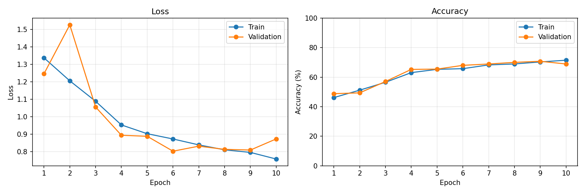

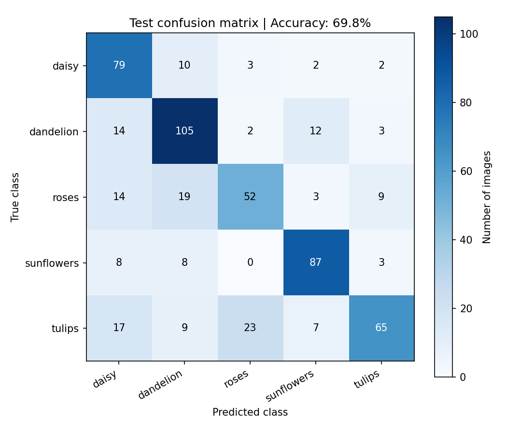

## 错分图片观察

通过 `review_errors.py` 读取已有的测试预测清单，不重新运行模型。
选择错误数量最多的三种“真实类别 → 预测类别”组合，
每种按清单顺序展示前两张，共六张。这是说明性样例，不是随机抽样。

```powershell
.\.venv\Scripts\python.exe review_errors.py "outputs/train_20261012_104629_645720_resume/evaluation"
```

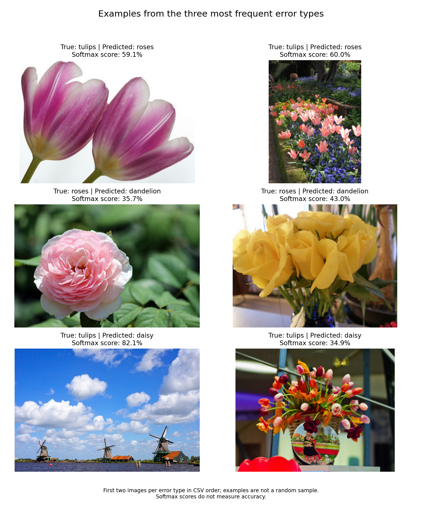

对样例的观察：

- 图片包含花朵特写、花园远景和花束，拍摄距离及背景差异较大。
- 一张标为郁金香的图片主要呈现天空和风车，花卉区域很小，
  提示部分样本需要进一步检查目标是否清晰、标签是否适合整图分类。
  仅凭该图不能确定标签错误，也不能确定模型使用了哪些特征。
- 该图片被预测为雏菊，softmax 分数为 82.1%，但预测与数据集标签不符。
  因此，较高的模型分数不能作为预测正确的保证。

以上观察用于说明局限，没有删除测试样本或改动测试标签；
测试准确率仍按全部 556 张图片计算。背景、目标大小等因素对模型的具体影响
需要另行设计验证实验，不能直接作为本次错误的已证实原因。

## 第二阶段：从五类扩展到 25 类

在原五类基础上新增二十类。新增图片来自
[牛津大学 Oxford Flowers102](https://www.robots.ox.ac.uk/~vgg/data/flowers/102/)，
TensorFlow 也在 [数据集目录](https://www.tensorflow.org/datasets/catalog/oxford_flowers102)
介绍该数据集。原来的 `flower_photos.tgz` 固定只有五类，扩展需要另一个数据包。
本项目继续用 PyTorch 训练，读取图片不需要安装 TensorFlow。

新增类别及清洗后的图片数如下，原五类编号 0～4 保持不变：

| 新增类别 | 类别编号 | 清洗后图片数 | 来源类别范围 |
| --- | ---: | ---: | --- |
| 百合（卷丹百合） | 5 | 45 | tiger lily |
| 荷花 | 6 | 137 | lotus |
| 兰花（选取三类） | 7 | 175 | moon orchid、hard-leaved pocket orchid、ruby-lipped cattleya |
| 山茶花 | 8 | 91 | camellia |
| 木槿属花卉 | 9 | 131 | hibiscus |
| 康乃馨 | 10 | 51 | carnation |
| 黄水仙 | 11 | 59 | daffodil |
| 鸢尾（选取两类） | 12 | 103 | bearded iris、yellow iris |
| 花菱草 | 13 | 102 | californian poppy |
| 矮牵牛 | 14 | 258 | petunia |
| 三角梅 | 15 | 128 | bougainvillea |
| 木兰属花卉 | 16 | 63 | magnolia |
| 万寿菊 | 17 | 67 | marigold |
| 睡莲 | 18 | 194 | water lily |
| 鹤望兰 | 19 | 85 | bird of paradise |
| 鸡蛋花 | 20 | 166 | frangipani |
| 红掌 | 21 | 105 | anthurium |
| 杜鹃花 | 22 | 96 | azalea |
| 仙客来 | 23 | 154 | cyclamen |
| 金鱼草 | 24 | 87 | snapdragon |

这里的百合、兰花等类别只覆盖表中明确选取的来源品种，
不代表已训练或验证了这些花卉的全部品种。来源类别的编号通过官方类别页的
示例图片与 `imagelabels.mat` 对照核实，映射保存在 `dataset_info.json`。

### 数据清洗与划分

组合前共 5968 个图片文件记录。按 RGB 像素和图片尺寸检查，
排除三个同标签的重复文件记录，以及一组相同图片、不同标签的两个文件记录，
最终保留 5963 张：训练集 4161 张、验证集 882 张、测试集 920 张。
不改动原五类图片或旧清单。相同图片标签冲突时，排除两条记录，不自动重标。
原五类其余图片保留原分组；新增类别使用固定种子划分为约 70%/15%/15%。
本实验没有使用 Oxford 官方分组，不能与它的官方基准成绩直接比较。

像素去重发现原五类有三组相同图片，其中两组跨数据分组，
一组同时具有玫瑰与郁金香两个标签。这是扩展阶段新增审计发现的问题。
因此，原 69.8% 保留为五类初版的实测成绩，不能视为已完成像素去重的基准。
新版独立清洗并排除了像素完全相同的重复数据，但不保证识别所有近似重复图。
原五类测试集成绩和错分图片也已被查看，所以 25 类合并测试集不是一份
完全未接触过的盲测数据；最终报告需保留这一限制。

独立结果在 `outputs/flower25/`，包含清单、类别统计图、数据来源映射及删除记录。

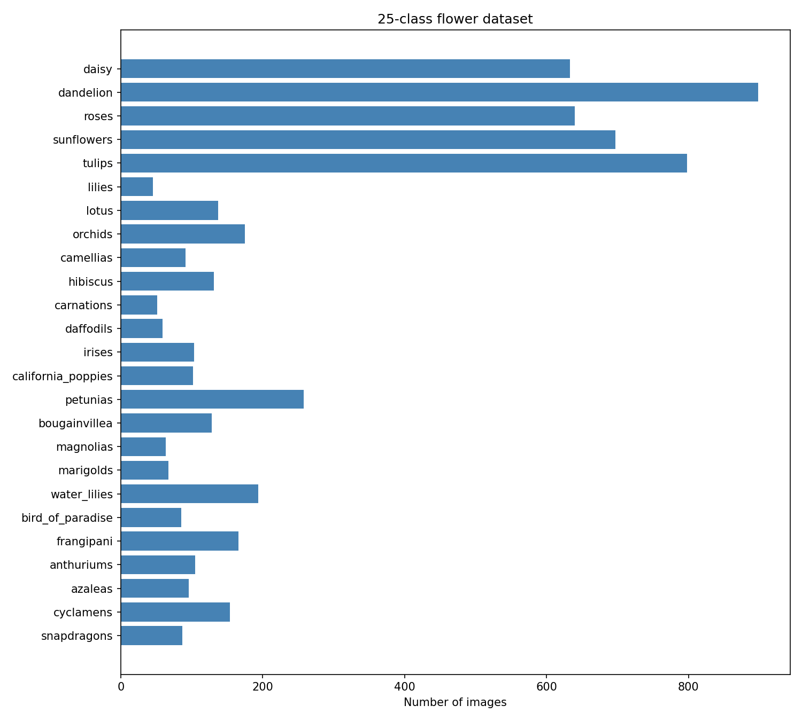

### 下载并准备扩展数据

在已准备原五类数据的基础上，运行：

```powershell
.\.venv\Scripts\python.exe -m pip install scipy==1.15.3
New-Item -ItemType Directory -Force data/flowers102
curl.exe --fail --location --output data/flowers102/imagelabels.mat https://www.robots.ox.ac.uk/~vgg/data/flowers/102/imagelabels.mat
curl.exe --fail --location --output data/flowers102/categories.html https://www.robots.ox.ac.uk/~vgg/data/flowers/102/categories.html
curl.exe --fail --location --output data/flowers102/README.txt https://www.robots.ox.ac.uk/~vgg/data/flowers/102/README.txt
curl.exe --fail --location --output data/flowers102/102flowers.tgz https://www.robots.ox.ac.uk/~vgg/data/flowers/102/102flowers.tgz
.\.venv\Scripts\python.exe prepare_flower25.py
```

已下载并准备好时，直接使用现有清单，无需重复下载。`--metadata-only` 只核对来源类别。
来源说明见 `outputs/flower25/oxford_README.txt`；原五类作者信息仍见原数据 `LICENSE.txt`。

### 二十五类训练

继续使用自己实现的 `FlowerResNet`，将分类层输出数设为 25，
参数数量为 2801465。此版本从随机初始化开始，未加载第三方预训练网络。
默认训练二十轮，采用 Adam、学习率 0.001、batch size 16、图片尺寸 128×128。

新增类别通常比原五类少，训练时按类别数量的倒数进行有放回抽样，
让每类被抽到的期望机会相同。此时一轮代表抽取与训练集大小相同的一批样本，
不是保证每张训练图片恰好使用一次。加入随机裁剪、水平翻转和轻度颜色变化；
验证与预测仍为 RGB、Resize 到 128×128、ToTensor，不使用随机增强。

选择最佳模型的指标改为**验证集各类别召回率的平均值**，
让每个类别在选模时具有相同权重，同时记录整体准确率。
这与第一阶段按验证准确率选模的规则不同，两阶段成绩不能直接作公平优劣比较。

先检查，再正式训练：

```powershell
.\.venv\Scripts\python.exe train_flower25.py --dry-run
.\.venv\Scripts\python.exe train_flower25.py --epochs 20
```

模型输出形状为 `[batch_size, 25]`。`--dry-run` 只检查，不开始训练。
正式训练保存到独立的 `outputs/train25_时间戳/`，包含配套清单、历史和最佳/最后模型。
如需继续到更多轮次，用本版本的最后模型恢复，并显式给出希望使用的学习率：

```powershell
.\.venv\Scripts\python.exe train_flower25.py --resume "outputs/本次25类训练目录/last_model.pth" --epochs 30 --lr 0.0003
```

### 训练完成后的运行方式

把以下占位目录替换为本次终端打印的真实目录：

```powershell
.\.venv\Scripts\python.exe plot_training.py "outputs/本次25类训练目录"
.\.venv\Scripts\python.exe predict.py "图片路径" --checkpoint "outputs/本次25类训练目录/best_model.pth"
.\.venv\Scripts\python.exe evaluate.py --checkpoint "outputs/本次25类训练目录/best_model.pth"
```

预测类别数及中文名以所选模型的元数据为准。没有指定 `--checkpoint` 时，
`predict.py` 默认仍加载旧五类初始模型；二十五类预测必须指定已训练的新权重。
评估自动读取训练目录内的配套清单。先根据验证集选定模型，再进行测试评估；
测试成绩作为最终报告，不用于反复调参。

### 二十五类首轮训练结果

本次实际完成二十轮，目录为 `outputs/train25_20261013_090830_128037/`。

| 轮次 | 验证准确率 | 验证平均类别召回率 |
| --- | ---: | ---: |
| 第 1 轮 | 13.0% | 19.7% |
| 第 12 轮 | 48.3% | 54.1% |
| 第 18 轮 | 61.2% | 67.9% |
| 第 20 轮（选中） | 59.6% | 68.6% |

第 18 轮整体准确率更高，第 20 轮平均类别召回率更高。
本阶段按后者选择最佳模型，因此选中第 20 轮；最佳与最后一轮检查点
在本次恰好对应同一轮，模型参数一致。

这说明按图片数量计算的整体准确率与每类等权计算的平均召回率
可能选出不同轮次。保留每类等权的规则，避免仅依据样本较多的类别选模。
以上是验证集结果。选定模型后的测试成绩如下；另有荷花图片的单张预测演示。

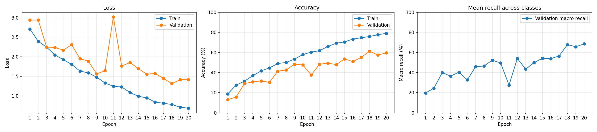

### 二十五类测试结果与错误分析

评估对象为按验证平均类别召回率选中的第 20 轮 `best_model.pth`，
结果保存在同一训练目录的 `evaluation/`。

| 测试指标 | 结果 |
| --- | ---: |
| 图片数 | 920 |
| 正确数 | 566 |
| 整体准确率 | 61.5% |
| 平均类别召回率 | 68.2% |
| 损失 | 1.1607 |

整体准确率是全部图片中预测正确的比例，样本较多的类别影响更大。
平均类别召回率先计算每类的正确比例，再对 25 个比例等权取平均，
所以两者不同。测试平均类别召回率与验证的 68.6% 接近，但不能据此
推断模型在所有新照片上都有相同表现。

| 类别 | 正确数 / 测试图片数 | 召回率 |
| --- | ---: | ---: |
| 雏菊 | 69 / 96 | 71.9% |
| 蒲公英 | 77 / 136 | 56.6% |
| 玫瑰 | 21 / 97 | 21.6% |
| 向日葵 | 101 / 106 | 95.3% |
| 郁金香 | 38 / 120 | 31.7% |
| 百合（卷丹百合） | 7 / 8 | 87.5% |
| 荷花 | 21 / 22 | 95.5% |
| 兰花（选取三类） | 23 / 27 | 85.2% |
| 山茶花 | 8 / 15 | 53.3% |
| 木槿属花卉 | 14 / 21 | 66.7% |
| 康乃馨 | 4 / 9 | 44.4% |
| 黄水仙 | 6 / 10 | 60.0% |
| 鸢尾（选取两类） | 11 / 16 | 68.8% |
| 花菱草 | 15 / 16 | 93.8% |
| 矮牵牛 | 25 / 40 | 62.5% |
| 三角梅 | 9 / 20 | 45.0% |
| 木兰属花卉 | 9 / 10 | 90.0% |
| 万寿菊 | 10 / 11 | 90.9% |
| 睡莲 | 27 / 30 | 90.0% |
| 鹤望兰 | 13 / 14 | 92.9% |
| 鸡蛋花 | 18 / 26 | 69.2% |
| 红掌 | 14 / 17 | 82.4% |
| 杜鹃花 | 10 / 15 | 66.7% |
| 仙客来 | 10 / 24 | 41.7% |
| 金鱼草 | 6 / 14 | 42.9% |

百合、荷花和兰花在这批测试样本上已有识别能力；其中百合仅有 8 张，
一张图片就会使该类召回率改变 12.5 个百分点，高比例仍需更多样本验证。
玫瑰和郁金香的召回率低于五类初版，扩大类别范围没有保证每个原有类别
都能保持原来的效果。两阶段还存在数据清洗、训练和选模规则的差异，
不能仅凭整体准确率将其作为同一任务下的公平对比。

主要错分去向如下：

- 玫瑰 → 康乃馨：31 张。
- 蒲公英 → 向日葵：30 张。
- 郁金香 → 向日葵：24 张。

错分图展示上述每种错误的前两张。玫瑰样例有层叠花瓣，蒲公英样例
包含种子球剪影和黄色花朵，郁金香样例包含花园远景和花朵特写。
这些是图片内容的观察，不能据此确定模型使用了哪些特征或错误的原因。
其中一张玫瑰被判为康乃馨，模型分数为 98.9%，再次说明高分不保证正确。

```powershell
.\.venv\Scripts\python.exe review_errors.py "outputs/train25_20261013_090830_128037/evaluation"
```

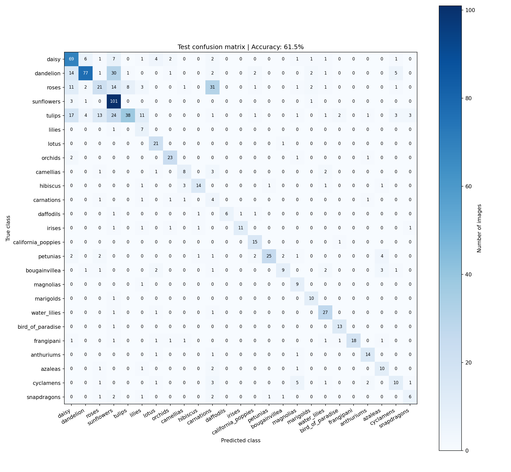

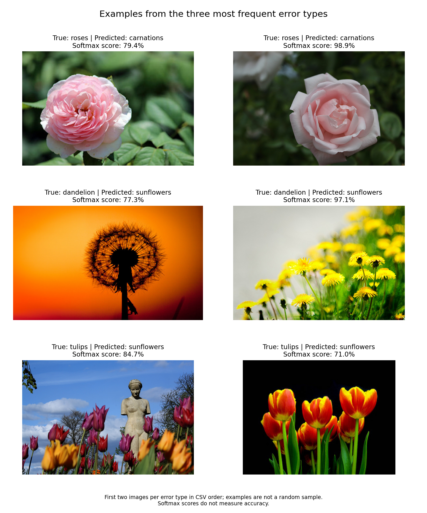

完整指标见 [每类测试结果](outputs/train25_20261013_090830_128037/evaluation/per_class_metrics.csv)
和 [整体测试记录](outputs/train25_20261013_090830_128037/evaluation/test_metrics.json)。
本次保留全部 920 张测试图片和原有标签，没有按错分情况删除测试样本。
后续若改进模型，应依靠训练集和验证集；已查看的测试结果用于报告局限。

### 新增类别的单张预测演示

以下使用一张项目数据集之外的荷花照片进行演示，运行时替换为实际图片路径：

```powershell
& .\.venv\Scripts\python.exe .\predict.py "C:\path\to\lotus.jpg" --checkpoint ".\outputs\train25_20261013_090830_128037\best_model.pth"
```

运行设备为 CUDA，使用第 20 轮选中的模型，输出类别为**荷花**，与这张图片的
内容一致。界面显示荷花分数 100.0%，实际 JSON 值约为 99.988%；
其他类别显示 0.0% 是保留一位小数后的显示结果，不表示其分数都严格为零。
模型分数是 25 个已知类别间的 softmax 结果，不是单张照片的“准确率”，
也不能由一次识别正确推断模型对所有新照片都可靠。
本次图片不参加训练、验证或测试集成绩的计算。

预测程序会将展示图及各类别分数记录保存到 `outputs/predictions/`。

## 单张图片的判断依据检查

### 新增检查如何使用

`explain_prediction.py` 加载现有权重，无需重新训练或安装额外 Python 库，
兼容五类和 25 类模型。图表使用中文字体，当前 Windows 环境使用微软雅黑；
其他系统可安装相应中文字体以显示中文。

```powershell
.\.venv\Scripts\python.exe explain_prediction.py "C:\Users\moruohan\Desktop\rose.jpg" --checkpoint "outputs/train25_20261013_090830_128037/best_model.pth" --box 0.11 0.02 0.90 0.97
```

换图片时替换路径，并根据图片调整 `--box x1 y1 x2 y2`。
坐标表示左上角和右下角在图片宽高中的比例，范围为 0～1，
例如 `0.25 0.25 0.75 0.75` 表示中央一半宽、一半高的矩形。
不传 `--box` 时使用这个中央矩形。展示图会用青色框标出选区，
它是人工矩形，不是自动花朵识别或花朵分割。

默认解释原图预测类别；指定 `--target roses` 可检查模型对玫瑰这一类别的
正向贡献，即使它没有把原图判为玫瑰。所有改图实验都比较同一个目标类别，
同时记录每张图实际预测的类别，避免将不同类别的分数混在一起比较。

| 检查 | 操作与要观察的内容 |
| --- | --- |
| Grad-CAM | 对目标类别的原始分数求梯度，以最后残差阶段 `stage4` 的输出生成热图，观察支持该分数的区域 |
| 遮挡选区 | 将框内替换为固定灰色，观察目标类别分数的变化 |
| 仅保留选区 | 将框外替换为固定灰色，观察目标类别分数的变化 |
| 灰度图 | 转灰度后复制为 RGB 三通道，观察改变颜色信息后的分数变化 |

热图原始尺寸为 8×8，插值放大到展示图片，位置只能粗略解释。
热图对本张图片归一化，亮度不能直接作跨图片或跨类别的贡献大小比较。
方法参考 [Grad-CAM 原论文](https://arxiv.org/abs/1610.02391)。
本实现以目标类别原始分数的空间平均梯度加权特征图，并保留正向贡献。
没有变化的正向热图会明确提示，而不伪造一个热点。

### 真实案例：玫瑰被误判为康乃馨

使用已核对真实类别的项目外玫瑰照片 `rose.jpg`，加载 25 类第 20 轮模型。
2026 年 10 月 14 日，用 `predict.py` 显式指定这一 25 类检查点，
原图仍被误判为**康乃馨 98.5%**，正确类别玫瑰只有 **1.4%**。
下方的解释图也复现了同一错误。
热图解释的目标为模型实际预测的**康乃馨**。
这次误判如实保留在结果分析中。

同一照片在未指定检查点时由默认的最初五类模型判为玫瑰（模型分数 78.7%）。
这说明要记录**具体使用的模型版本**：五类和 25 类模型的类别范围及训练参数不同，
不能将两个分数直接当作同一模型的前后变化。

| 图片处理 | 实际预测类别 | 同一个目标“康乃馨”的模型分数 | 相比原图变化 |
| --- | --- | ---: | ---: |
| 原图 | 康乃馨 | 98.5% | 0.0 个百分点 |
| 遮挡选区 | 仙客来 | 2.5% | -96.0 个百分点 |
| 仅保留选区 | 康乃馨 | 99.2% | +0.7 个百分点 |
| 灰度图 | 雏菊 | 0.3% | -98.3 个百分点 |

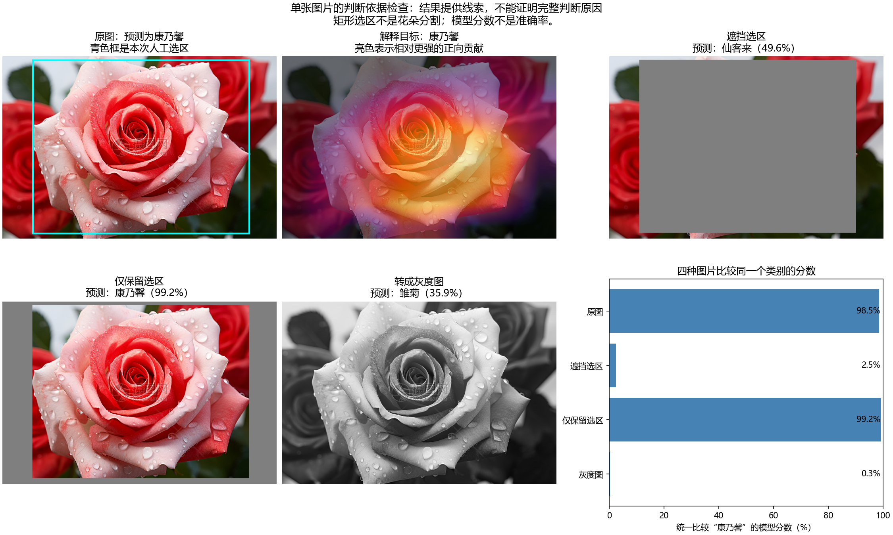

热图较亮区域集中在中央花朵的部分花瓣区域。矩形覆盖了中央花朵的大部分，
也包含少量其他内容；框外仍有其他花朵，所以不能把两种遮挡操作称为
“只看花朵”和“只看背景”。遮挡选区和灰度处理使康乃馨分数明显下降，
说明这些输入修改影响了本次分类。这些结果提供空间区域和颜色变化的线索，
但不能证明模型具体依据了哪种花瓣形状、纹理或植物学特征。
图中还有水印，没有单独检查它的影响，不能断言模型完全忽略了水印。

本次结果也说明：模型可以在花朵区域产生热区，同时高分误判；
“关注花朵”不等于“识别正确”。灰色遮挡和灰度处理会改变输入分布，
分数下降还可能包含这种变化带来的影响，不能据一次实验确定完整原因。

图片与 JSON 检查记录保存在 `outputs/explanations/`，记录包括模型路径、
目标类别、选区、各类别分数和相对原图的变化，便于复查。
生成热图时仅对输入和特征求梯度，模型使用评估模式且参数冻结，
不执行优化器更新；这张演示照片不计入验证或测试成绩。

已检查已知梯度的定位结果、全零热图、遮挡边界以及五类/25 类兼容性；
检查前后原始预测一致，模型参数和 BatchNorm 状态未变化。

## 错误跟踪与后续修改记录

**当前问题：25 类模型将已知的玫瑰照片判为康乃馨。**
它不是一次偶然的终端显示差异：固定验证集里，玫瑰仅识别正确 22/96 张，
另有 29/96 张被判为康乃馨；固定测试集里，玫瑰仅识别正确 21/97 张，
另有 31/97 张被判为康乃馨。单张玫瑰照片的错误和两个数据分组中的
薄弱类别相符，但不能据此断定具体原因。尤其是训练使用按类别数量倒数的
有放回抽样，较少的康乃馨训练图片可能被重复抽到；这只是待检验的假设。

| 日期 | 版本或变更 | 观察与验证 | 状态 |
| --- | --- | --- | --- |
| 2026-10-13 | 25 类初版，第 20 轮，`train25_20261013_090830_128037/best_model.pth` | 测试准确率 61.5%、平均类别召回率 68.2%；玫瑰召回率 21.6%，玫瑰→康乃馨 31 张 | 保留为对照基线 |
| 2026-10-14 | 原图 `rose.jpg`，显式加载上述 25 类模型；未修改权重 | 实际是玫瑰，预测康乃馨 98.5%、玫瑰 1.4%；热图和遮挡对比提供局部线索 | 错误未解决 |
| 2026-10-14 | 第二张项目外玫瑰照片 `rose1.jpg`，同一 25 类模型；未修改权重 | 仍预测康乃馨 63.2%，玫瑰 30.7%；说明第一张照片的失败并非唯一案例 | 错误未解决 |
| 2026-10-14 | 增加 `explain_prediction.py` 和判断依据图；分类模型未修改 | 检查前后原图预测一致；增加了解释能力，没有提高分类正确率 | 已完成解释功能 |
| 2026-10-14 | 增加 `check_validation.py`，仅用现有 25 类权重检查验证集；分类模型未修改 | 验证准确率 59.6%、平均类别召回率 68.6%；玫瑰 22/96 正确，其中 29 张被判为康乃馨；康乃馨 6/7 正确，其中 1 张被判为玫瑰 | 已复现类别混淆，原因待检验 |
| 2026-10-14 | 独立训练候选版本：只将训练抽样指数从 1 改为 0.5；仍为手写 ResNet、相同分组、随机种子和二十轮训练 | 最佳第 20 轮验证准确率 66.6%、平均类别召回率 69.0%；玫瑰 33/96 正确，玫瑰→康乃馨降至 6 张；康乃馨 4/7 正确 | 有改善也有退步；旧模型保留 |
| 2026-10-14 | 用同一张项目外 `carnation.jpg` 比较两版 25 类模型 | 两版均判对康乃馨：初版显示 100.0%，候选版显示 94.5%；这是各自对单张图片的模型分数 | 不能由分数下降推断候选版总体准确率下降 |
| 2026-10-14 | 用第二张项目外玫瑰 `rose1.jpg` 检查候选版 | 初版判为康乃馨 63.2%，候选版判为蒲公英 95.2%，候选版给玫瑰 3.7%；两版都判错 | 减少了某一种混淆，但玫瑰识别问题未解决 |
| 2026-10-14 | 复核玫瑰训练图，仅在独立清单排除 27 张无清晰玫瑰主体的图片，再按候选版设置重新训练 | 最佳第 19 轮验证准确率和平均类别召回率均为 61.2%；玫瑰 24/96 正确，低于未清洗候选版 33/96 | 此次清洗实验未改善验证效果，保留权重供分析，不替换候选版 |

后续每次修改模型或数据，都在此表**追加一行**，写明日期、改动、
新模型文件或运行目录、验证集整体准确率、平均类别召回率、
玫瑰及康乃馨召回率、额外照片的预测结果，以及是否保留该版本。
保留本次 25 类模型与原始结果，避免覆盖基线。

使用以下命令可重复计算现有验证集的混淆矩阵和上述数字，不重新训练：

```powershell
& .\.venv\Scripts\python.exe .\check_validation.py --checkpoint ".\outputs\train25_20261013_090830_128037\best_model.pth"
```

结果保存在该训练目录的 `validation_analysis/`，包括完整混淆矩阵、
每张验证图片的预测清单和摘要。可根据已有清单生成错分样例图：

```powershell
& .\.venv\Scripts\python.exe .\review_errors.py ".\outputs\train25_20261013_090830_128037\validation_analysis" --predictions-file val_predictions.csv
```

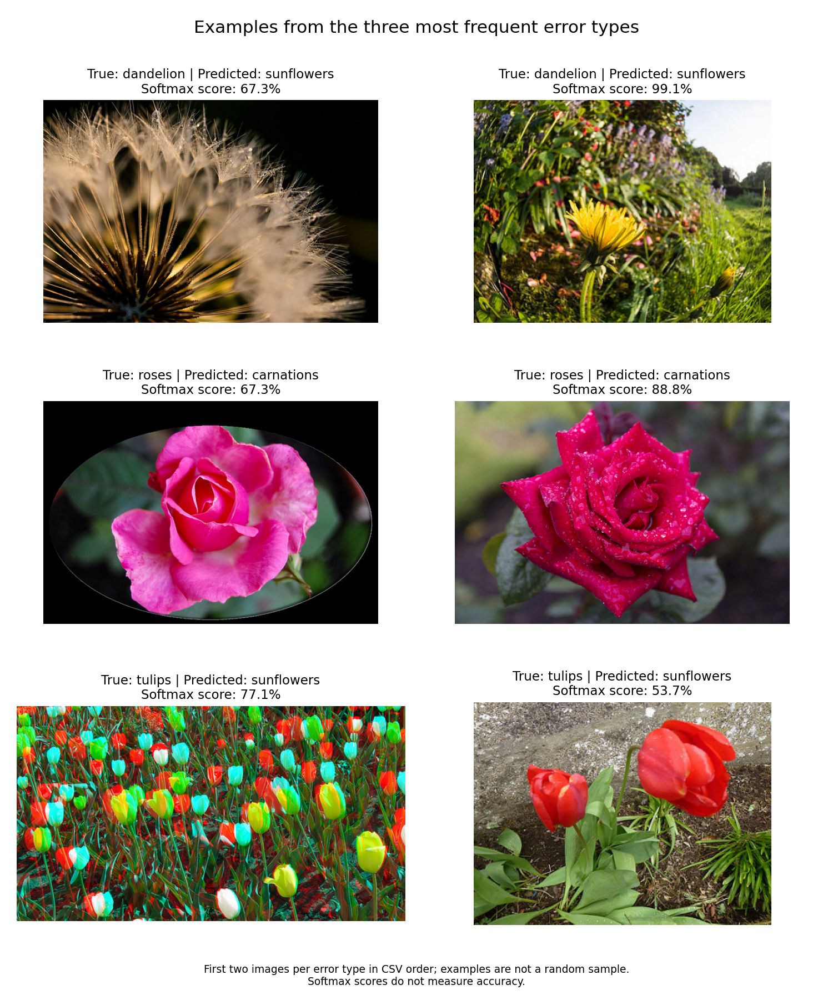

图中间一行的两张玫瑰分别被判为康乃馨，分数为 67.3% 和 88.8%。
它们只是固定清单顺序中的两个样例，不能代表 29 张错分玫瑰的全部情况。
康乃馨在验证集中只有 7 张，高召回率不能单独说明已学好这个类别。
本次独立训练只改一项：把类别抽样指数由 1 降到 0.5，
减少少量类别图片被重复抽到的程度，同时仍给它们高于自然频率的抽取机会。
其余保持相同的 25 类网络、固定分组、随机种子、增强和二十轮设置。
原版每轮给玫瑰与康乃馨各约 4% 的期望抽样机会；新版本约为
玫瑰 7.4%、康乃馨 2.1%。这是训练方式的对照试验，并未修改类别标签。

```powershell
& .\.venv\Scripts\python.exe .\train_flower25.py --epochs 20 --lr 0.001 --sampler-power 0.5
& .\.venv\Scripts\python.exe .\check_validation.py --checkpoint ".\outputs\train25_20261014_152630_011600\best_model.pth"
```

| 固定验证集指标 | 初版抽样指数 1 | 候选抽样指数 0.5 |
| --- | ---: | ---: |
| 25 类平均类别召回率 | 68.6% | 69.0% |
| 整体准确率 | 59.6% | 66.6% |
| 玫瑰召回率 | 22/96，22.9% | 33/96，34.4% |
| 玫瑰 → 康乃馨 | 29 张 | 6 张 |
| 玫瑰 → 蒲公英 | 2 张 | 18 张 |
| 康乃馨召回率 | 6/7，85.7% | 4/7，57.1% |
| 被预测为蒲公英的验证图片总数 | 95 张 | 201 张 |

新版本保存在 `outputs/train25_20261014_152630_011600/`，旧模型及原始成绩没有覆盖。
玫瑰错判为康乃馨的数量减少，但玫瑰仍只有约三分之一识别正确，
而康乃馨召回率下降。平均类别召回率仅高 0.4 个百分点，
不足以断言新方案在所有新照片上更好。康乃馨验证样本仅 7 张，
一张的变化就占 14.3 个百分点。抽样调整与这些结果同时出现，
但单次训练和有限样本不能完全证明具体错判的原因。
桌面照片由使用者自行输入程序。`carnation.jpg` 在候选版上判对，
`rose1.jpg` 却从“错判康乃馨”变成“错判蒲公英”。
候选版验证集也出现了同方向的变化：玫瑰误判蒲公英从 2 张增至 18 张，
被预测为蒲公英的图片总数从 95 张增至 201 张；这表明错误转向了另一类别，
不能只看玫瑰→康乃馨减少这一项。
下图中间一行展示两张真正的玫瑰被候选版判为蒲公英的验证图片；
它们是清单顺序中的样例，不能代替全部 18 张的检查。

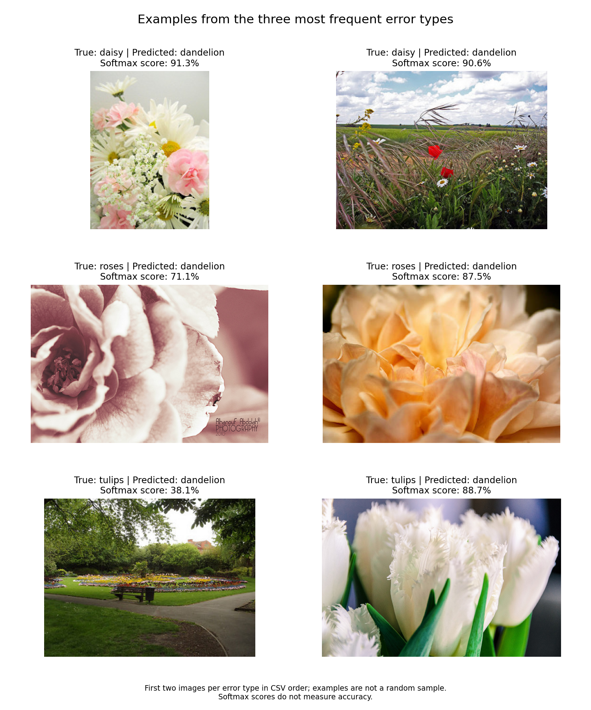

候选版的验证集玫瑰召回率虽由 22/96 提高到 33/96，仍有 63/96 张判错；
单张照片的模型分数不能当成实测准确率，
也不能单凭这几张桌面照片选择模型。
新方案只用训练集学习、验证集比较；
已经查看过的测试集和这些桌面照片不作为挑选最佳模型的依据。
这样才能区分“只让这一张照片变对”和“整体识别能力真的改善”。

### 玫瑰与蒲公英的数据标签检查（2026-10-14）

按候选版验证集的错分方向，检查了玫瑰、蒲公英和康乃馨的原始图片。
运行 `audit_flower_labels.py`，对三类共 **1589 张**逐张检查文件是否存在、
能否解码、类别编号是否与清单一致、图片所在文件夹及来源是否匹配，
并重新计算像素摘要核对清单；这些**结构与文件检查发现 0 项问题**。
这只证明记录与文件一致，不能证明图片内容真的属于所写花种。

```powershell
& .\.venv\Scripts\python.exe .\audit_flower_labels.py
```

脚本在 `outputs/flower25/label_audit/` 生成审查摘要、
玫瑰训练集全部 447 张的分页面板、随机抽查的蒲公英训练图 36 张、
康乃馨训练图 35 张，以及候选版误判为蒲公英的 18 张验证玫瑰。
缩略图用于人工检查，可按上述命令重新生成。

逐页查看玫瑰训练集后，列出 **28 张需要打开原图复核的候选**，
清单见 `outputs/flower25/label_audit/review_candidates.csv`。
其中打开原图核对的例子包括骑马游行
`4292443009_3a2831b0b9_m.jpg`、街上电车
`12450781274_eb78723921.jpg`、蘑菇
`15537825851_a80b6321d7_n.jpg` 和宠物照片
`3265902330_d8b1e44545.jpg`；它们被放在 `roses` 文件夹，
但画面没有可用于学习花卉外观的清晰玫瑰主体。
候选数量**不是已确认的错标率**，有些远景或游行可能包含很小的花。
随后逐张打开这 28 张原图，发现其中一张
`3145692843_d46ba4703c.jpg` 实际是玫瑰花束，决定保留；
其余 27 张或没有清晰玫瑰主体，或属于其他花种，
只在下面的独立训练实验中排除。原始图片与原始清单均未改动。

随机抽查的蒲公英训练图主要展示黄色花朵或白色种子球；
康乃馨样图大多展示花朵，但训练集只有 35 张，不能由抽查证明整类标签完全正确。
候选版误判为蒲公英的 18 张验证玫瑰中，大部分可看到玫瑰；
另有一张 `17953368844_be3d18cf30_m.jpg` 实际以建筑拱顶为主体，
同样列为复核候选。可见数据噪声值得处理，
但**不能用少数明显不相关的图片解释所有玫瑰错判**。

### 只清洗训练集的对照实验

`prepare_clean_train.py` 按上述复核决定另存清单：玫瑰训练图从 447 张减至
420 张，全部训练图从 4161 张减至 4134 张；验证 882 张、测试 920 张
均与原清单逐行相同。建筑拱顶那张验证图虽然被标记为异常，也保留在
**相同的验证集**中，以保证两版模型比较时没有更换考题。

```powershell
& .\.venv\Scripts\python.exe .\prepare_clean_train.py
& .\.venv\Scripts\python.exe .\train_flower25.py --data-info .\outputs\flower25_clean_train_v1\dataset_info.json --epochs 20 --lr 0.001 --sampler-power 0.5 --samples-per-epoch 4161
```

这里与上一次候选版保持同一网络、随机种子、学习率、二十轮训练、
抽样指数 0.5 和每轮 4161 次抽取；训练图数量与抽样概率则因清洗而变化。
最佳模型仍按验证集平均类别召回率挑选。只比较固定验证集，
这轮没有再次查看测试集。

| 固定验证集指标 | 未清洗候选版 | 清洗训练图后的版本 |
| --- | ---: | ---: |
| 最佳轮次 | 20 | 19 |
| 25 类平均类别召回率 | 69.0% | 61.2% |
| 整体准确率 | 66.6% | 61.2% |
| 玫瑰召回率 | 33/96，34.4% | 24/96，25.0% |
| 玫瑰 → 蒲公英 | 18 张 | 21 张 |
| 玫瑰 → 康乃馨 | 6 张 | 16 张 |
| 玫瑰 → 郁金香 | 15 张 | 24 张 |
| 蒲公英召回率 | 114/134，85.1% | 120/134，89.6% |
| 康乃馨召回率 | 4/7，57.1% | 5/7，71.4% |

清洗版最佳权重保存在
`outputs/train25_20261014_164649_042406/best_model.pth`，
对照版在 `outputs/train25_20261014_152630_011600/best_model.pth`。
这次单轮对照中，清洗版的玫瑰和整体指标下降；
蒲公英、康乃馨略有上升，但康乃馨验证图仅 7 张。
**不能由一次训练推断“清洗造成了下降”**：重新训练会受随机抽样和优化波动影响。
可以确定的是，排除这 27 张训练图**没有在本次验证中修复玫瑰识别**，
因此不将清洗版替换为项目推荐的 25 类模型，也不据此改写原始数据清单。

### 预训练特征的独立对照

手写 ResNet 从随机参数开始学习，仍是本项目考核的主体。
为检查“小数据训练”是否限制了识别能力，新增 `train_transfer25.py`：
使用 [PyTorch 提供的 ResNet18 权重](https://download.pytorch.org/models/resnet18-f37072fd.pth)
作为已有图像特征，冻结其卷积部分，**只训练最后的 25 类分类层**。
预训练权重放在 `data/pretrained/`，训练脚本会核对其 SHA256 校验值。

这项对照使用**原始、未清洗的 25 类训练清单**，训练 4161 张、验证 882 张；
抽样指数仍为 0.5，训练 10 轮，用同一固定验证集的平均类别召回率选模型。
预训练网络、224 像素输入及归一化方式都与手写模型不同，
所以这是另一种完整方案的效果对照，不能把提升归因于单一改动。

```powershell
& .\.venv\Scripts\python.exe .\train_transfer25.py --epochs 10 --lr 0.001 --sampler-power 0.5
& .\.venv\Scripts\python.exe .\check_validation.py --checkpoint .\outputs\transfer25_20261014_171804_046181\best_model.pth
```

| 固定验证集指标 | 手写 25 类候选版 | 预训练特征对照 |
| --- | ---: | ---: |
| 最佳轮次 | 20 | 6 |
| 整体准确率 | 66.6% | 87.4% |
| 25 类平均类别召回率 | 69.0% | 91.4% |
| 玫瑰召回率 | 33/96，34.4% | 71/96，74.0% |
| 玫瑰 → 康乃馨 | 6 张 | 0 张 |
| 玫瑰 → 蒲公英 | 18 张 | 0 张 |
| 玫瑰 → 郁金香 | 15 张 | 10 张 |
| 蒲公英召回率 | 114/134，85.1% | 123/134，91.8% |
| 康乃馨召回率 | 4/7，57.1% | 7/7，100.0% |

预训练对照最佳模型保存在
`outputs/transfer25_20261014_171804_046181/best_model.pth`。
验证集 882 张中正确 771 张；康乃馨验证图片仅 7 张，
`7/7` 不代表它面对所有康乃馨都可靠。
错分样例仍包含“玫瑰 → 郁金香”，其中一张原图以游行为主体，
说明固定验证集本身也有噪声；这里只记录现象，没有根据结果删改验证图片。
选定第 6 轮检查点后，仅运行一次该模型的固定测试集评估；
`evaluate.py` 会根据模型类型使用与验证一致的图片处理方式：

```powershell
& .\.venv\Scripts\python.exe .\evaluate.py --checkpoint .\outputs\transfer25_20261014_171804_046181\best_model.pth
```

测试集 920 张中正确 **812 张，准确率 88.3%**，25 类平均召回率 **90.6%**；
玫瑰 **67/97（69.1%）**，康乃馨 **7/9（77.8%）**。
玫瑰有 13 张被判为郁金香、1 张被判为康乃馨，仍存在混淆。
结果文件在 `outputs/transfer25_20261014_171804_046181/evaluation/`。
错分对照图中，一张黄色玫瑰花束和一张以人物为主体、背景含玫瑰的照片
都被判为郁金香。它们提示花色与主体占比可能影响判断，
但仅凭这两张样例还不能确定网络具体依据了什么。
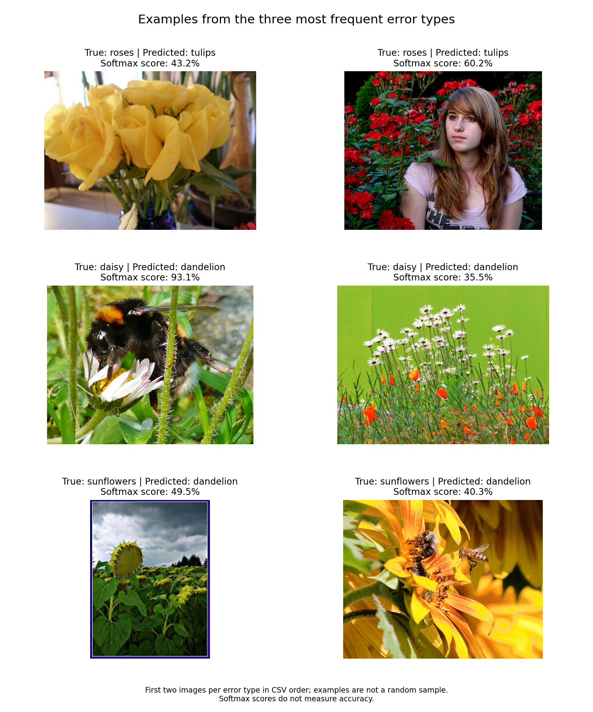

这份合并测试集的原五类部分曾在前期手写模型分析中被查看，
玫瑰问题也影响了后续实验方向，因此这里的测试结果**不是完全盲测**；
模型的第 6 轮权重仍只依据验证集指标选定，没有依据这次测试结果调参。

`predict.py` 已能按检查点自动选择正确的网络和图片处理方式。
使用者可以自己把新图片路径传给程序；需要同时指定该对照模型的检查点：

```powershell
& .\.venv\Scripts\python.exe .\predict.py "C:\path\to\flower.jpg" --checkpoint .\outputs\transfer25_20261014_171804_046181\best_model.pth
```

### 项目外玫瑰照片复查

对同一张项目外照片 `rose1.jpg` 使用不同模型：初版 25 类手写模型
判为康乃馨（康乃馨 63.2%、玫瑰 30.7%），调整抽样的手写候选版
判为蒲公英（蒲公英 95.2%、玫瑰 3.7%）；
预训练特征对照的第 6 轮模型则**正确判为玫瑰**，模型分数玫瑰 92.4%、
郁金香 6.6%、康乃馨 0.1%。
另一张项目外照片 `rose.jpg` 曾被初版 25 类模型判为康乃馨（康乃馨 98.5%、
玫瑰 1.4%）；同一个预训练对照模型则**正确判为玫瑰**，
模型分数玫瑰 99.9%、郁金香约 0.0%。
至此，这两张已知真实类别的项目外玫瑰照片在新模型下都得到正确分类，
修复了这两个具体失败案例；两张照片不能代表所有玫瑰，
92.4% 和 99.9% 都是单张图的模型分数，不是总体准确率。
后续不据此反复调整测试集指标。

此前手写模型、数据划分和结果均保留。即使对照模型在验证集更好，
仍需用更多项目外图片检验实际效果；单张图片的高分不是总体准确率。

## 手写 25 类模型接续训练改进（2026-10-20）

项目外的 `rose3.jpg` 是玫瑰。初版手写 25 类模型将其判为康乃馨，
模型分数为康乃馨 55.6%、玫瑰 25.5%。先前固定验证集也显示玫瑰识别偏弱，
因此继续改进手写模型，而不是将预训练 ResNet18 的权重用于这个模型。

本次从抽样指数为 0.5 的手写候选版第 20 轮 `last_model.pth` 接续训练；
网络结构、25 类数据划分及抽样方式保持不变，总轮次增加到 30，
学习率设为 0.0003。额外训练轮数与学习率同时变化，不能将改进归因于其中一项。
每轮仍按固定验证集的平均类别召回率选模，最终选中第 28 轮。
从零复现时，先运行 20 轮候选版，再将下面的目录替换成终端显示的实际目录：

```powershell
& .\.venv\Scripts\python.exe .\train_flower25.py --epochs 20 --lr 0.001 --sampler-power 0.5
& .\.venv\Scripts\python.exe .\train_flower25.py --resume ".\outputs\第一次训练目录\last_model.pth" --epochs 30 --lr 0.0003 --sampler-power 0.5
& .\.venv\Scripts\python.exe .\check_validation.py --checkpoint ".\outputs\接续训练目录\best_model.pth"
```

| 固定验证集指标 | 接续前候选版（第 20 轮） | 接续后选中版（第 28 轮） |
| --- | ---: | ---: |
| 整体准确率 | 66.6% | 79.0% |
| 25 类平均召回率 | 69.0% | 79.6% |
| 玫瑰召回率 | 33/96（34.4%） | 54/96（56.2%） |
| 康乃馨召回率 | 4/7（57.1%） | 4/7（57.1%） |

选定检查点后，在同一份 920 张测试集上得到 743 张正确，准确率 80.8%，
25 类平均召回率 80.1%。与最初的手写 25 类模型相比，玫瑰从 21/97
提高到 58/97；但康乃馨从 4/9 降到 1/9。这说明整体和玫瑰识别有所改善，
部分小类别仍不稳定，不能称为所有类别都已解决。
测试集及部分项目外照片此前已被查看，因此这项比较不是全新的盲测结果。

同一张 `rose3.jpg` 用第 28 轮手写模型预测为玫瑰：玫瑰分数 62.3%、
康乃馨 33.5%。这只是一个具体正确案例，不能代替固定数据集评估，
也不能证明以后每张玫瑰都能判对。
